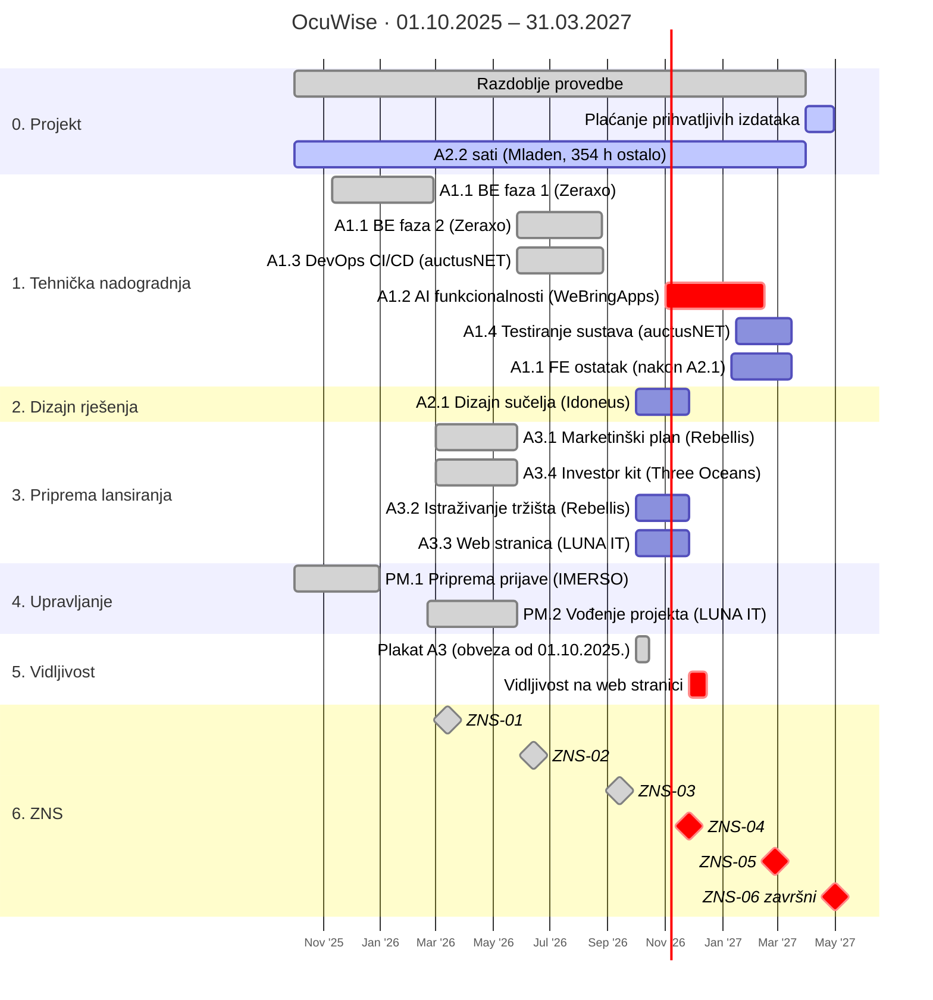

[< Back to OcuWise MoC](00-funding-ocuwise-moc.md)

Kontrolna bilješka za fazu provedbe. Rokovi, obveze i dokumentacija uz ZNS vode se odvojeno u [Rokovi, Reporting, Obaveze, ZNS](40-funding-ocuwise-zns-rokovi-obaveze.md) — ovdje se ne ponavljaju.

## 1. Plan aktivnosti

^gantt-ocuwise

---
## 2. Redoslijed aktivnosti

1. [**A2.1 prije ostatka A1.1**](31-funding-ocuwise-provedba-aktivnosti.md)
    - Ugovoreni opis A1.1 veže frontend uz *„redizajn korisničkog sučelja koje je definirano u aktivnosti Dizajn korisničkog sučelja"*;
    - Modularizacija sučelja ima smisla tek kad je poznata konačna struktura ekrana, pa se preostalih 10.000 € A1.1 troši nakon Idoneus isporuke;
2. [**A1.2 — critical**](31-funding-ocuwise-provedba-aktivnosti.md):
    - 42.000 €, najveća pojedinačna stavka mora nastati **i biti plaćena** do 31.03.2027;
    - Sve ostalo stane u raspored oko nje;
3. [**A1.4 nakon A1.2**](31-funding-ocuwise-provedba-aktivnosti.md):
    - Testiranje sustava ima smisla na dovršenim AI funkcionalnostima;
    - AuctusNET već ima uspostavljenu kontrolu regresije iz A1.3 kao osnovicu;
4. **A3.2 na gotovom proizvodu:**
    - Validacija potreba korisnika je reprezentativna tek kad postoji ono što se validira;
5. **A3.3 povlači obvezu vidljivosti:**
    - Objavom web stranice aktivira se čl. 50(1)(a);
    - Elementi moraju stajati od prvog dana, ne naknadno;

---
## 3. Financijski okvir

### 3.1 Predujam i poravnanje

- **Predujam**: 39.257,44 € = točno 30 % bespovratnih sredstava, isplaćen unaprijed;
- ZNS-01 i ZNS-02 poravnati su s predujmom; **ZNS-03 ga je zatvorio i donio prvu stvarnu uplatu**;

| Stavka | Iznos |
| ------ | ----- |
| Predujam primljen | 39.257,44 € |
| Poravnano ZNS-01 | 11.067,68 € |
| Poravnano ZNS-02 | 20.981,65 € |
| Poravnano/isplaćeno ZNS-03 | 24.154,84 € |
| **Ukupno odobreno** | **56.204,18 €** |
| **Neto isplaćeno u gotovini** | **16.946,73 €** |

> [!check] Predujam je zatvoren
> Sva tri ZNS-a su odobrena i plaćena. Od ukupno odobrenih 56.204,18 € bespovratnih, 39.257,44 € bilo je unaprijed isplaćeno kao predujam, pa je neto priljev **16.946,73 €** (uplata zaprimljena 06.10.2026.). Od ZNS-04 nadalje cijeli odobreni iznos ide u isplatu.

---
## 4. Stanje proračuna po stavkama

Iznosi = prihvatljivi troškovi u EUR. Stanje **potraživano zaključno s ZNS-03**.

| Stavka   | Opis                                         | Izvršitelj       | Ugovoreno      | Plaćeno       | Preostalo za plaćanje |
| -------- | -------------------------------------------- | ---------------- | -------------- | ------------- | --------------------- |
| A1.1     | Optimizacija backend i frontend sustava      | Zeraxo           | 39.500,00      | 29.500,00     | 10.000,00             |
| A1.2     | Nadogradnja AI funkcionalnosti               | We Bring Apps    | 42.000,00      | 0             | 42.000,00             |
| ~~A1.3~~ | ~~DevOps CI/CD~~                             | auctusNET        | 12.000,00      | 12.000,00     | 0                     |
| A1.4     | Testiranje sustava                           | auctusNET        | 10.000,00      | 0             | 10.000,00             |
| A2.1     | Dizajn korisničkog sučelja                   | Idoneus          | 15.000,00      | 0             | 15.000,00             |
| A2.2     | Trošak djelatnika (Mladen Posavec)           | interno          | 10.242,54      | 7.626,48      | 2.616,06              |
| ~~A3.1~~ | ~~Marketinški plan, kanali, alati~~          | ~~Rebellis~~     | ~~10.000,00~~  | ~~10.000,00~~ | ~~0~~                 |
| A3.2     | Istraživanje tržišta i validacija            | Rebellis         | 13.500,00      | 0             | 13.500,00             |
| A3.3     | Izrada web stranice                          | LUNA IT          | 8.000,00       | 0             | 8.000,00              |
| ~~A3.4~~ | ~~Pripreme za sljedeći ciklus investiranja~~ | ~~Three Oceans~~ | ~~10.000,00~~  | ~~10.000,00~~ | ~~0~~                 |
| ~~PM.1~~ | ~~Vanjski stručnjak — priprema prijave~~     | ~~IMERSO~~       | ~~4.000,00~~   | ~~4.000,00~~  | ~~0~~                 |
| ~~PM.2~~ | ~~Vanjski stručnjak — vođenje projekta~~     | ~~LUNA IT~~      | ~~3.000,00~~   | ~~3.000,00~~  | ~~0~~                 |
| —        | Fiksna stopa 7 % (neizravni troškovi)        | —                | 12.406,98      | 5.328,85      | 7.078,13              |
|          | **UKUPNO**                                   |                  | **189.649,51** | **81.455,33** | **108.194,18**        |

- **A2.2**:
    - satnica 7,39 €/h je **fiksna za cijelu provedbu**;
    - preostalo **354 sata** (1.032 od 1.386 potraživano);
    - svaki sat = 7,9073 € prihvatljivo > 5,4560 € bespovratnih;
- **PM.1 + PM.2 = 7.000 €**:
    - točno na limitu Poziva za vanjske stručnjake; **u toj skupini više se ništa ne može potraživati**;
- Fiksna stopa od 7 % pokriva i **promidžbu i vidljivost**:
    - Aktivnost 5 nema izravni proračun, pa se troškovi vidljivosti nikada ne prijavljuju kao izravni;

---
## 5. Povijest ZNS-ova

| ZNS    | Razdoblje                 | Podneseno   | Status              | Potraživano | Odobreno (BS) |
| ------ | ------------------------- | ----------- | ------------------- | ----------- | ------------- |
| ZNS-01 | 26.11.2025. – 26.02.2026. | 13.03.2026. | Odobren i plaćen 01.04.2026. | 16.040,12 | 11.067,68 |
| ZNS-02 | do 26.05.2026.            | 12.06.2026. | Odobren i plaćen 06.07.2026. | 30.408,20 | 20.981,65 |
| ZNS-03 | do 26.08.2026.            | 09.2026.    | Odobren i plaćen 06.10.2026. | 35.007,01 | 24.154,84 |

- **ZNS-01**:
    - A1.1 prva faza — 9.500;
    - A2.2 — 743 h;
    - fiksna stopa;
- **ZNS-02**:
    - A2.2 — 192 h;
    - A3.1, A3.4, PM.1, PM.2;
    - fiksna stopa;
- **ZNS-03**:
    - A1.1 druga faza — 20.000;
    - A1.3 — 12.000;
    - A2.2 — 97 h (06/2026: 45, 07/2026: 32, 01.–26.08.2026: 20);
    - fiksna stopa;

### 5.1 ZNS-04 — u pripremi

Rok: **13.12.2026.**, izvještajno razdoblje završava 26.11.2026. U trackeru su svijetloplavo označene stavke koje se dovršavaju i potražuju u ovom ZNS-u.

| Stavka | Izvršitelj | Iznos |
| ------ | ---------- | ----- |
| A2.1 Dizajn korisničkog sučelja | Idoneus | 15.000,00 |
| A3.2 Istraživanje tržišta i validacija | Rebellis | 13.500,00 |
| A3.3 Izrada web stranice | LUNA IT | 8.000,00 |
| **Izravno** | | **36.500,00** |

| Scenarij | Izravno | Fiksna stopa | Prihvatljivo | Bespovratno |
| -------- | ------: | -----------: | -----------: | ----------: |
| A2.1 + A3.2 + A3.3 | 36.500,00 | 2.555,00 | 39.055,00 | **26.947,95** |

- Predujam je zatvoren, pa **cijeli odobreni iznos ide u isplatu**;
- A2.2: preostalo 354 sati, ali **još nisu odrađeni** — dodaju se tek kad budu; svaki sat nosi 7,9073 € prihvatljivo / 5,4560 € bespovratno;
- Uz svaki ZNS ide **Izjava o radu** potpisana od nadređene osobe;

> [!warning] Ne citirati 22.285,75 € prema PT2
> Excel izvoz u stupcu „Odobrena BS" za ZNS-02 **udvostručuje dvije fiksne stope** (A3: 1.932 umjesto 966; PM: 676,20 umjesto 338,10). Kumulativni stupac je točan: 46.448,32 × 0,69 = 32.049,33, što odgovara 11.067,68 + **20.981,65**. Razlika 1.304,09 € je greška prikaza.

---
## 6. Nabava i izvršitelji

> [!important] Dva različita seta ponuda — ne miješati
> **Informativne ponude** (u `ocuwise-prijava/ponude-informativne-za-prijavu/`) služile su samo za dokazivanje tržišnih cijena pri prijavi i **nikada nisu obvezivale na izbor izvršitelja**.
> 
> **Ponude iz nabave** (u `ocuwise-provedba/ponude-nabava/`) su stvarna nabava provedena nakon dodjele i **mjerodavne su** za opseg, cijenu i izvršitelja.

| Stavka      | Izvršitelj           | Ponuda        | Datum       | EUR             |
| ----------- | -------------------- | ------------- | ----------- | --------------- |
| A1.1        | Zeraxo d.o.o.        | 425-037-10300 | 10.11.2025. | 39.500          |
| A1.2        | We Bring Apps d.o.o. | 11-2025       | 07.11.2025. | 42.000          |
| A1.3 + A1.4 | auctusNET d.o.o.     | 22/VP-01/1    | 20.02.2026. | 12.000 + 10.000 |
| A2.1        | Idoneus d.o.o.       | —             | 16.02.2026. | 15.000          |
| A3.1 + A3.2 | REBELLIS, obrt       | 04018         | 11.02.2026. | 10.000 + 13.500 |
| A3.3        | LUNA IT, obrt        | P-1-2026      | 20.02.2026. | 8.000           |
| A3.4        | Three Oceans d.o.o.  | 46/1/1        | 12.02.2026. | 10.000          |
| PM.1        | IMERSO               | 08/001/2025   | 12.03.2025. | 4.000           |
| PM.2        | LUNA IT, obrt        | P-2-2026      | 20.02.2026. | 3.000           |

- Svaki iznos ponude **točno odgovara** svojoj proračunskoj stavci;
- **Pravilo roka** — Upute 9.2:
    - *„Postupci nabave ne mogu biti zaključeni prije početka razdoblja provedbe projekta."*;
    - provedba počinje 01.10.2025., a sve ponude iz nabave su kasnije — **uredno**;
    - jedina ranija je IMERSO (12.03.2025.) — po naravi priprema prijave, već odobreno u ZNS-02;

> [!check] Nabava je zatvorena
> Postupak je proveden u cijelosti na početku provedbe: izrađen i predan **Plan nabave**, poslani zahtjevi za ponudu, prikupljena i arhivirana dokumentacija. Ostaje samo tekuća isporuka i plaćanje po sklopljenim ugovorima — **nema otvorenih nabavnih radnji**.

---
## 7. Pokazatelji

| Pokazatelj | Polazno | Cilj | Rok |
| ---------- | ------- | ---- | --- |
| RCR01 — stvorena radna mjesta (EPRV) | 1,00 | 2,00 | m+1 |
| RCO05 — novoosnovano poduzeće koje prima potporu | 0 | 1 | kraj provedbe |
| Broj inovativnih proizvoda | 0 | 1 | kraj provedbe (TRL 8) |
| RCR03 — inovacija proizvoda/procesa | 0 | 1 | prvi odobreni ZNS |
| RCR04 — marketinška/organizacijska inovacija | 0 | 1 | prijava na ZNS |
| Povećanje prihoda od prodaje | 18.545 | **130.000** (tj. povećanje od 111.455) | m+3 |
| Dodatno financiranje | 0 | 200.000 | m+3 |
| Nastavak poslovanja | 0 | 1 | m+3 |

> [!caution] Financijske korekcije kod neispunjenja
> Prosjek ostvarenja pokazatelja rezultata:
> - ≥85 % → 0 %;
> - 70–85 % → 4 %;
> - 50–70 % → 7 %;
> - <50 % → **10 %**;
> 
> ukupnih bespovratnih sredstava.

---
## 8. Otvorene točke i rizici

1. **A2.2**:
    - preostala **354 sata / 2.616,06 €**, još neodrađena;
    - tvrdi limit 1.386 sati ukupno — sati iznad toga nisu naplativi;
2. **Vidljivost — plakat** A3 POSTAVLJEN TIJEKOM 09/2026 na zid u OctoMoon uredu, Jasenak):
    - *čl. 50(1)(d) Uredbe 2021/1060 traži **najmanje jedan tiskani plakat A3** na mjestu jasno vidljivom javnosti, obveza teče od 01.10.2025*;
        - U Prijavnom obrascu stoji „Znakovlje/plakat postavljen na lokaciji projekta: **Ne**", što obvezu **ne ukida** — Opći uvjeti kažu „u svakom slučaju";
    - Sankcija u ovom Pozivu: 1 % = **1.308,58 €**. Plakat je izrađen: `ocuwise-provedba/vidljivost/`;
    - **Pazi na ZNS-04**:
        - stavka A3.3 (web stranica, LUNA IT) isporučuje se u tom razdoblju;
        - Objavom stranice aktivira se i čl. 50(1)(a):
            - *amblem EU-a, izjava „Sufinancira Europska unija" i kratak opis projekta moraju stajati na njoj **od prvog dana**, vidljivi bez skrolanja i u mobilnoj verziji*;
3. **Rokovi ZNS-a**:
    - Datumi potječu iz **službene poruke PT2 kroz sustav eKohezija**;
        - Mjerodavno: Opći uvjeti i vlastita bilješka potvrđuju da sva komunikacija s PT2 ide **isključivo** kroz eKoheziju, uputa PT2 ima prednost pred općim rokom iz Uputa (15 dana od isteka tromjesečja);
    - Raspored [Rokovi, Reporting, Obaveze, ZNS](40-funding-ocuwise-zns-rokovi-obaveze.md);
4. **RCR01 — dvojba razriješena u korist 2 nova zaposlenja**:
    - [Grant Application, Deliverables](10-funding-ocuwise-prijava-deliverables.md) „*2 — Stvorena radna mjesta*": 2 konkretna radna mjesta (AI inženjer + voditelj komercijalizacije);
    - Radna mjesta zadržati najmanje godinu dana nakon završetka;
5. **Nedostaje u project folderu**:
    - **Potpisan Ugovor** — samo u papirnatom obliku i opsežan je;
        - Nije hitno, bitni uvjeti poznati su iz Priloga 1 i 2, a raspored ZNS-ova riješen je porukom PT2;
    - **Odluka o financiranju jest u folderu** (`rezultati/sluzbeni-rezultati/`);

---
## 9. Praćenje plaćanja

Plaćanja se vode u **`ocuwise-tracker-placanja.xlsx`** .

- **Boja retka označava status** — četiri stanja, redom kako stavka napreduje:
    - **siva** — spava; ništa se još ne događa;
    - **žuta** — dio aktivnosti je isporučen **i** plaćen; stavka je u tijeku;
    - **zelena** — u cijelosti isporučeno i plaćeno;
    - **plava** — planirano za iduće razdoblje **i** za potraživanje u idućem ZNS-u; trenutno **A2.1, A3.2, A3.3** (redovi 15, 21, 23) → ZNS-04, vidi 5.1;

> [!warning] Što tracker i dalje ne pokazuje točno
> Boje su sređene, ali dvije brojke u stupcu V ostaju krive:
> - **A2.2** — u V stoji punih 10.242,54 €, a stvarno preostaje **2.616,06 € (354 sata)**; kroz ZNS-01, ZNS-02 i ZNS-03 potrošeno je 1.032 sata. Plaća nije uplata dobavljaču pa je tracker ne prati;
> - **PM.1** — u V stoji 4.000 €, iako je stavka potraživana i odobrena u ZNS-02; sama uplata sjedi na retku *Priprema projekta* (30.12.2025.);
> - **zbroj V5** (107.500 €) preskače redak A2.2 i sve retke fiksne stope, a uključuje izvanproračunski redak *Priprema projekta* — nije usporediv s „preostalo" iz 4. poglavlja;

> [!note] Priprema projekta — izvan proračuna, interno praćenje
> Redak 31 (*Priprema projekta*, 13.000 €, Andreja i Dora) **nije projektna stavka**.
> - 4.000 € prihvatljivo je kao PM.1;
> - preostalih **9.000 € je success fee vanjskih EU savjetnika** — u cijelosti vlastiti trošak, **nema nikakve veze s HAMAG-BICRO-om** i ne prijavljuje se ni u jednom ZNS-u; prati se samo interno;
> - zbog tog retka ukupni zbroj u trackeru (202.649,52 €) premašuje ugovoreni proračun za točno 13.000 €;

---
## Related

[OcuWise MoC](00-funding-ocuwise-moc.md), [Rokovi, Reporting, Obaveze, ZNS](40-funding-ocuwise-zns-rokovi-obaveze.md), [Grant Application, Deliverables](10-funding-ocuwise-prijava-deliverables.md), [OcuWise Finance](41-funding-ocuwise-finance.md),
